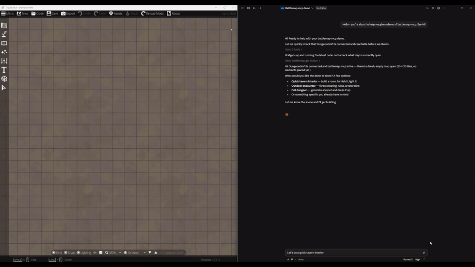

# battlemap-mcp

An AI collaborator for your Dungeondraft maps: a local bridge that lets your AI assistant (Claude Desktop, Claude Code, Codex, OpenCode, or any other MCP client) build, inspect, and refine the map you have open, using assets you already own.

**Documentation: [knownframe.com/battlemap-mcp/docs](https://knownframe.com/battlemap-mcp/docs/)**

Sped up 11×; the full build took about five minutes.

## Support creators first

This is a local automation layer for your own Dungeondraft map-making session. It does **not** generate original assets or art for you; it drives what you already own in Dungeondraft. Please buy and support Dungeondraft, and support the artists whose asset packs you use.

## What you can make

Build a whole map from a brief, plan an encounter together, furnish one room, export to or rebuild from a Universal VTT file, or hand off tedious placement. See [example prompts](https://knownframe.com/battlemap-mcp/docs/example-prompts/).

## Get started

You need **Dungeondraft 1.2.0.1** and an AI app that can run local MCP servers, on the same computer. Follow **[Get started](https://knownframe.com/battlemap-mcp/docs/get-started/)**, then the [Windows](https://knownframe.com/battlemap-mcp/docs/windows/), [macOS](https://knownframe.com/battlemap-mcp/docs/macos/) or [Linux](https://knownframe.com/battlemap-mcp/docs/linux/) guide. Downloads are on the [Releases](https://github.com/thekannen/battlemap-mcp/releases) page.

### Include your asset packs

See [Include your asset packs](https://knownframe.com/battlemap-mcp/docs/asset-packs/).

### Install from Claude

Use the Claude desktop extension or the Claude Code plugin: see [Install from Claude](https://knownframe.com/battlemap-mcp/docs/install-from-claude/).

### Platform limits

See [Platform limits](https://knownframe.com/battlemap-mcp/docs/known-limitations/#platform-limits).

### If something does not work

See [Troubleshooting](https://knownframe.com/battlemap-mcp/docs/troubleshooting/).

## Documentation

- [Example prompts](https://knownframe.com/battlemap-mcp/docs/example-prompts/)
- [Tool reference](https://knownframe.com/battlemap-mcp/docs/tools/): every tool, generated from the server
- [Technical reference](https://knownframe.com/battlemap-mcp/docs/technical-reference/) · [Known limitations](https://knownframe.com/battlemap-mcp/docs/known-limitations/)
- [Privacy](https://knownframe.com/battlemap-mcp/docs/privacy/) · [Legal and attribution](https://knownframe.com/battlemap-mcp/docs/legal/)

For contributors: [Bridge protocol](docs/PROTOCOL.md), [Developer installation](docs/developer-installation.md), [Building releases](docs/releases.md), [Contributing](CONTRIBUTING.md), [Changelog](CHANGELOG.md).

## Affiliation and legal

`battlemap-mcp` is an independent, unofficial project and is **not** sponsored, operated, or endorsed by Megasploot or Tailwind Games, LLC. It does not include or redistribute Dungeondraft software, maps, or art assets. See [Legal and attribution](https://knownframe.com/battlemap-mcp/docs/legal/).
